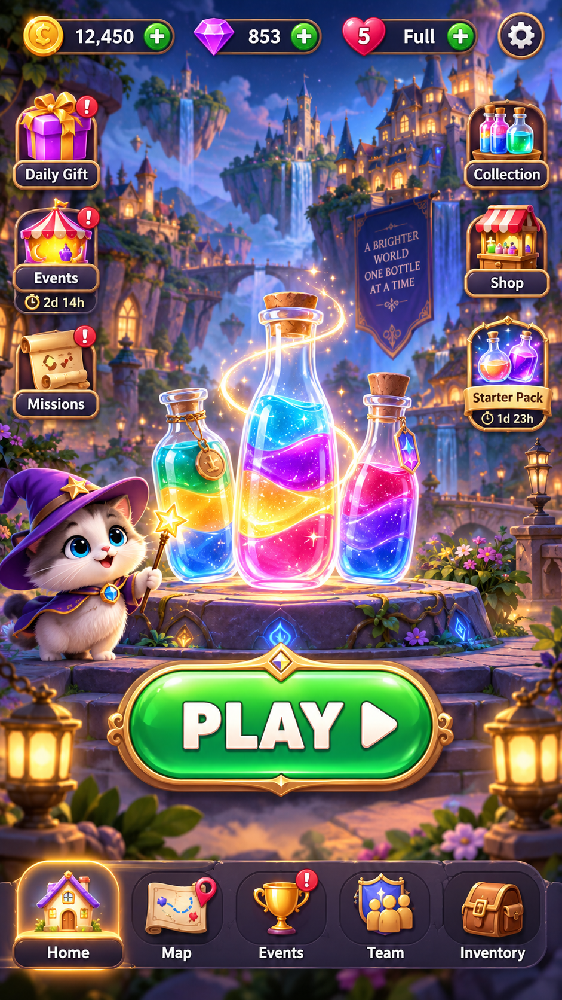
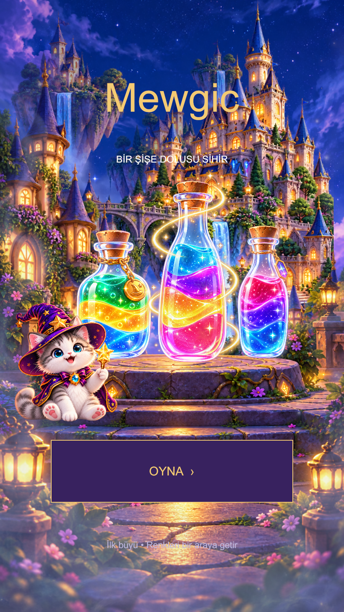

# PART 03C — Referans / gerçek Game View

| Hedef referans | Unity Home — gerçek900×1600 Game View |
|---|---|
|  |  |

Kompozisyon: sol/orta/sağ sırası ve baskın orta şişe korunur; kedi sol altta, PLAY alttadır. Şişeler mevcut taş platformdadır. Onaylı sprite'ların camı/spirali korunur. Arka plan ve UI önceki aşamalardan gelir; farklılıklar PART03C_REPORT.md içinde açıklanmıştır.
